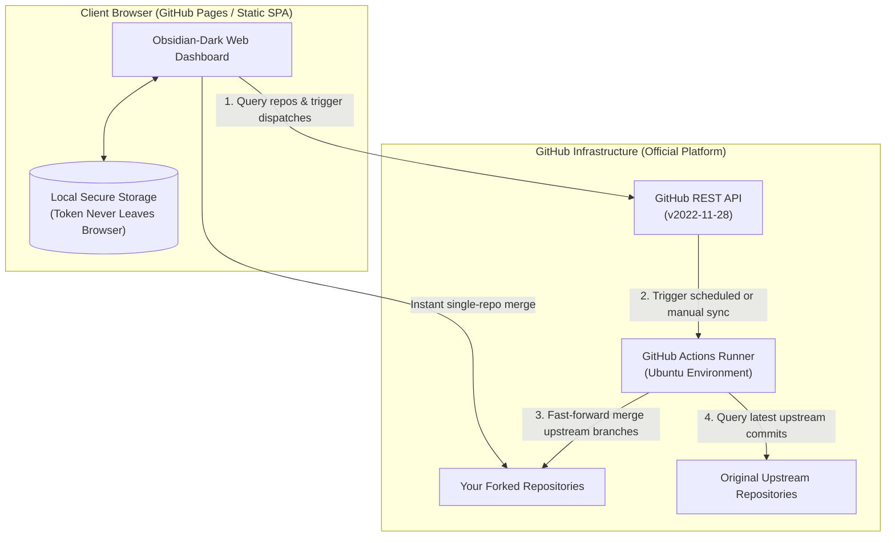

<div align="center">

# ForkSync Hub

**Automated Cloud-Native Upstream Synchronization & Interactive Web Dashboard for GitHub Forks**

<p align="center">
  <b>English</b> · 
  <a href="README_zh.md">简体中文</a> · 
  <a href="README_zh_tw.md">繁體中文</a> · 
  <a href="README_ja.md">日本語</a>
</p>

<p align="center">
  <a href="https://github.com/waw666waw666/fork-auto-sync/actions/workflows/sync.yml"></a>
  <a href="https://github.com/waw666waw666/fork-auto-sync/blob/main/LICENSE"></a>
  
  
  
</p>

<p align="center">
  <b>Keep all your forked repositories effortlessly in sync with upstream.</b><br />
  <i>100% serverless, zero server maintenance costs, zero local machine pollution, and zero third-party token leakage.</i>
</p>

<p align="center">
  <a href="#-quick-start-1-minute-setup">Quick Start</a> •
  <a href="#-why-forksync-hub">Why ForkSync?</a> •
  <a href="#-key-features">Key Features</a> •
  <a href="#-architecture">Architecture</a> •
  <a href="#-security--privacy">Security & Privacy</a> •
  <a href="#-configuration">Configuration</a> •
  <a href="#-faq">FAQ</a> •
  <a href="#-license">License</a>
</p>

---

</div>

> [!TIP]
> 🌐 **Interactive Live Web Demo**: **[https://waw666waw666.github.io/fork-auto-sync/](https://waw666waw666.github.io/fork-auto-sync/)**  
> *100% client-side zero-trust security — your access credentials stay strictly inside your browser's local memory and are never uploaded to any remote server.*

---

## 🎯 Why ForkSync Hub?

When you fork dozens or hundreds of open-source projects on GitHub, keeping them updated with the upstream creators becomes a tedious manual chore:
- **Pain Points of Traditional Workflows**: You must repeatedly visit every repository's GitHub page to click `Sync fork`, or maintain scheduled scripts on a personal server or local PC—wasting electricity, risking disk pollution, and managing merge conflicts blindly.
- **Flaws of Existing Tools**: Conventional Actions scripts operate inside a headless black box with **zero visual dashboard**, offering no visibility into release tags or sync history. Meanwhile, third-party sync SaaS services demand full access tokens sent to unknown external servers—creating catastrophic security risks.

**ForkSync Hub changes everything**: It combines a **modern Obsidian-dark serverless web dashboard** with a **GitHub Actions native orchestration engine**. You do not need to buy or configure servers—simply **1-Click Fork** this repository to get your own private cloud synchronization control center!

---

## ✨ Key Features

| Feature | Description |
| :--- | :--- |
| 🌐 **Immersive Web Dashboard** | Precision Obsidian Dark (`#0b0f19`) and Emerald Green engineering UI. Monitor all your forked repositories, tracked branches, upstream author, release versions, and synchronization statuses at a glance. |
| 🔒 **End-to-End Zero-Trust Security** | Your GitHub Personal Access Token (PAT) is stored **exclusively in your browser's local storage**. The web application speaks directly with the official GitHub REST API over HTTPS. Zero third-party relay servers, 100% open-source and auditable. |
| ⚙️ **Real-Time Web Schedule Control** | Switch cloud sync frequency directly from the browser (e.g. Every 2h, Every 6h, Twice Daily, Daily 09:00). Changes are committed directly back to `.github/workflows/sync.yml` via GitHub API without touching a local terminal. |
| 📦 **Upstream Deletion Safeguard** | Automatically inspects upstream repository existence. If the original upstream creator has deleted their repo or deleted their account (HTTP 404), ForkSync Hub marks it as `📦 Upstream Deleted · Exclusive Mirror` and locks it, preventing destructive 409 errors. |
| ⚡ **Dual-Track Sync Architecture** | **Instant Single-Repo Sync**: Direct client-side `merge-upstream` with live streaming console logs. <br/>**Full Cloud Sync**: 1-click trigger GitHub Actions cloud container with real-time poll tracking and execution duration metrics. |
| 🛑 **Granular Rules & Exclusion List** | Include or exclude specific repositories dynamically with toggle checkboxes. Repositories you want to keep static will never be overwritten. |
| 📱 **Responsive & Accessible** | Optimized for mobile, tablet, and ultra-wide displays with single clean scroll containers, zero scroll bleed, and keyboard shortcuts (`/` for search, `Esc` to close modals). |

---

## 🏗️ Architecture



---

## 🚀 Quick Start (1-Minute Setup)

Deploying your own private synchronization station takes less than 60 seconds and zero coding:

### Step 1: Fork this Repository
Click the **Fork** button in the top right corner of this repository to clone it into your personal GitHub account.

### Step 2: Configure Repository Secret
1. Go to GitHub [Personal Access Tokens (Classic)](https://github.com/settings/tokens).
2. Generate a new token with the following scopes:
   - `repo` (Full control of private and public repositories)
   - `workflow` (Required to update workflow files and dispatch Actions)
3. In your forked repository, navigate to **Settings** → **Secrets and variables** → **Actions**.
4. Click **New repository secret**:
   - **Name**: `SYNC_TOKEN`
   - **Secret**: Paste the Personal Access Token generated above.

### Step 3: Enable GitHub Pages Dashboard
1. In your forked repository, go to **Settings** → **Pages**.
2. Under **Build and deployment** → **Source**, select **GitHub Actions**.
3. The built-in workflow will automatically build and publish your web console to:
   ```
   https://<your-username>.github.io/fork-auto-sync/
   ```
4. Visit your URL, enter your token into the private lock screen, and enjoy your automated synchronization dashboard!

---

## ⚙️ Configuration

ForkSync Hub can be configured either through the **interactive web settings modal** or by editing `config.json` directly in the repository:

```json
{
  "description": "ForkSync configuration file for repository exclusion and targeting.",
  "exclude": [
    "repo-to-skip",
    "username/archived-project"
  ],
  "only": []
}
```

- `exclude`: List of repository names or full names (`owner/repo`) that should **never** be synchronized with upstream.
- `only`: (Optional) If populated, only the specified repositories will be synchronized.

---

## 🔒 Security & Privacy Architecture

Security is the core design pillar of ForkSync Hub:

1. **Zero Intermediate Servers**: The dashboard runs purely on static GitHub Pages. No backend database, no proxy server, and no third-party analytics.
2. **Local-Only Credential Persistence**: Your GitHub Token is only stored in browser `localStorage` or `sessionStorage` (user-selectable). It is never sent anywhere except directly to `https://api.github.com`.
3. **Conflict Protection**: When upstream changes conflict with local commits (HTTP 409), the system will **never** force-overwrite your code. It halts safely and alerts you on the dashboard.
4. **Upstream 404 Archival Protection**: If an upstream author deletes their repository, your fork is safely locked as an irreplaceable permanent archive.

---

## ❓ Frequently Asked Questions (FAQ)

<details>
<summary><b>Q: Does this cost anything to run?</b></summary>
<b>No.</b> Both GitHub Actions and GitHub Pages are 100% free for public repositories. Even for private forks, GitHub provides generous free monthly Actions minutes (2,000+ minutes/month), which is more than enough for thousands of sync runs.
</details>

<details>
<summary><b>Q: Why does the token require the <code>workflow</code> permission?</b></summary>
GitHub security policies require the <code>workflow</code> scope whenever a tool modifies <code>.github/workflows/*.yml</code> files (such as when you adjust the cron schedule from the web dashboard) or dispatches workflow runs. Your token remains strictly between your browser and GitHub.
</details>

<details>
<summary><b>Q: What happens if an upstream repository has code conflicts with my fork?</b></summary>
The synchronization engine adheres to a strict safe-merge protocol. If a conflict occurs, GitHub returns HTTP 409 and the runner automatically preserves your commits without altering code. The dashboard will tag the repository with a warning badge and provide a one-click diff comparison link.
</details>

<details>
<summary><b>Q: Can I use this for private repositories?</b></summary>
Yes. Ensure your Personal Access Token has the <code>repo</code> scope, and all your private forks will appear securely in your dashboard.
</details>

---

## 🤝 Contributing

Contributions, issues, and feature requests are welcome!  
Feel free to check out the [issues page](https://github.com/waw666waw666/fork-auto-sync/issues).

---

## 📄 License

This project is open-sourced under the [MIT License](LICENSE).  
Feel free to fork, customize, and share!
