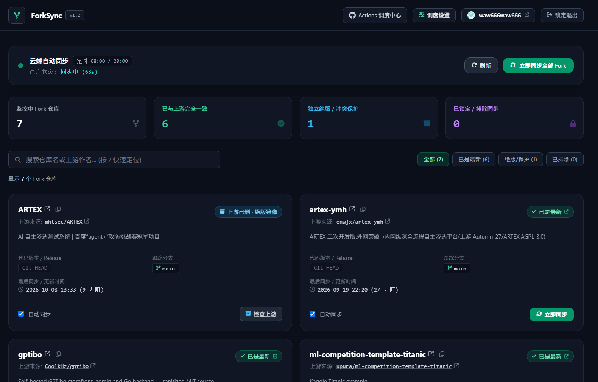
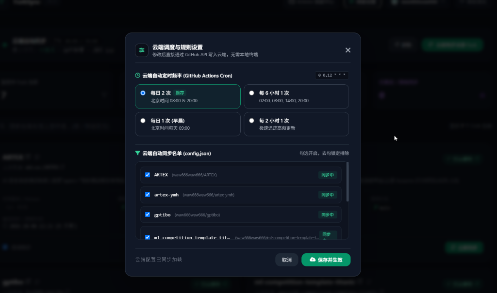
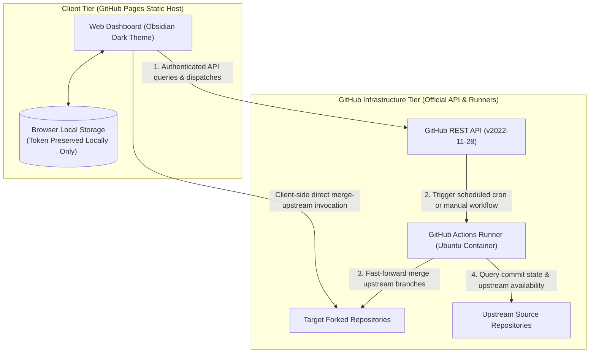

<div align="center">

# ForkSync Hub

**Automated Cloud-Native Upstream Synchronization & Interactive Web Dashboard for GitHub Forks**

<p align="center">
  <a href="README.md">简体中文</a> · 
  <b>English</b> · 
  <a href="README_zh_tw.md">繁體中文</a> · 
  <a href="README_ja.md">日本語</a>
</p>

<p align="center">
  <a href="https://github.com/waw666waw666/fork-auto-sync/actions/workflows/sync.yml"></a>
  <a href="LICENSE"></a>
  
  
  
</p>

<p align="center">
  Continuous, automated upstream synchronization engine and visual operation console for GitHub forked repositories.<br />
  Operates on 100% serverless infrastructure, requiring zero server maintenance, zero local compute resources, and zero third-party token exposure.
</p>

<p align="center">
  <a href="#overview">Overview</a> •
  <a href="#user-interface">User Interface</a> •
  <a href="#system-architecture">System Architecture</a> •
  <a href="#core-capabilities">Core Capabilities</a> •
  <a href="#deployment-guide">Deployment Guide</a> •
  <a href="#configuration-specification">Configuration</a> •
  <a href="#security-and-data-privacy-model">Security & Privacy</a> •
  <a href="#security-cautions-and-disclaimer">Security & Disclaimer</a> •
  <a href="#technical-faq">FAQ</a> •
  <a href="#license">License</a>
</p>

---

</div>

## Overview

ForkSync Hub is an open-source, serverless management solution engineered to solve upstream drift across GitHub forked repositories.

### Background

Maintaining synchronization across dozens or hundreds of forked repositories presents substantial operational friction:
* **Manual Overhead**: Upstream changes necessitate visiting individual repository pages on GitHub to execute manual merge operations.
* **Local Burden**: Running local cron daemons or background scripts consumes local hardware resources, risks Git workspace pollution, and creates unmonitored local conflicts.
* **Security Deficits of External SaaS**: Third-party synchronization services require transmitting personal access tokens with write permissions to unverified remote servers, introducing severe credential leakage risks.

### The Solution

ForkSync Hub unifies a client-side, zero-trust Single Page Application (hosted on GitHub Pages) with an automated container execution pipeline (running on GitHub Actions). The system operates directly against GitHub's official REST API over HTTPS, delivering automated tracking, conflict preservation, and real-time scheduling controls without external infrastructure requirements.

---

## User Interface

### Main Dashboard

The primary console provides centralized visibility into repository health, tracking branches, release versions, upstream authorship, and synchronization statuses.

<p align="center">
  
</p>

### Cloud Schedule & Rule Settings

The settings panel enables modifying workflow execution intervals and repository exclusion lists via direct GitHub API commits, eliminating command-line intervention.

<p align="center">
  
</p>

---

## System Architecture

The following diagram illustrates the unidirectional data flow and zero-trust boundary separating client credentials from GitHub cloud execution:



---

## Core Capabilities

| Capability | Specification |
| :--- | :--- |
| **Visual Management Dashboard** | Engineering-grade Obsidian dark interface (`#0b0f19`) displaying tracking branches, release tags, upstream status, and last synced timestamps in real time. |
| **Client-Side Zero-Trust Model** | Personal Access Tokens (PAT) are stored solely within client-side browser storage and communicate exclusively with `https://api.github.com`. No relay or proxy servers are utilized. |
| **Dynamic Schedule Control** | Interactive selection of synchronization intervals (e.g., Every 2 hours, Every 6 hours, Twice daily, Daily at 09:00 UTC+8). Settings are committed directly to `.github/workflows/sync.yml`. |
| **Conflict Shield & Preservation** | Non-destructive merging strictly rejects conflicting branches (HTTP 409) to guarantee personal custom commits are never overwritten or force-pushed. |
| **Upstream Deletion Safeguard** | Automated verification of upstream repository status. If an upstream repository is deleted or made private (HTTP 404), the system locks synchronization to preserve the local fork as an immutable independent archive. |
| **Dual-Track Execution Pipeline** | **Direct Merge**: Client-side single-repository merge via GitHub's `merge-upstream` endpoint with real-time streaming execution logs.<br/>**Cloud Batch**: Workflow dispatch triggering GitHub Actions runner with status polling and runtime duration calculation. |
| **Granular Rule Filtering** | Configurable repository filtering via `config.json` supporting targeted inclusion and explicit exclusion to protect customized branches. |
| **Rate-Limit Safe Concurrency** | Throttled batch processing and per-repository cool-down intervals shield the user account against GitHub secondary rate limit triggers. |
| **Responsive Design & Accessibility** | Cross-platform layout optimization across desktop, tablet, and mobile devices with scroll locking, single scroll containers, and keyboard navigation. |

---

## Deployment Guide

Deployment requires approximately 60 seconds and utilizes GitHub's native free tier:

### Step 1: Fork the Repository
Click the **Fork** button at the top right of this repository to create an independent copy under your GitHub personal or organizational account.

### Step 2: Configure the Synchronization Secret
1. Navigate to GitHub [Personal Access Tokens (Classic)](https://github.com/settings/tokens).
2. Generate a token with the following scopes:
   * `repo` (Full repository access for public and private repositories)
   * `workflow` (Required for updating workflow definition files and triggering dispatches)
3. In your forked repository, go to **Settings** → **Secrets and variables** → **Actions**.
4. Click **New repository secret**:
   * **Name**: `SYNC_TOKEN`
   * **Secret**: Paste the Personal Access Token generated above.

### Step 3: Enable GitHub Pages
1. In your forked repository, navigate to **Settings** → **Pages**.
2. Under **Build and deployment** → **Source**, select **GitHub Actions**.
3. The deployment workflow will automatically publish your console to:
   ```
   https://<your-username>.github.io/fork-auto-sync/
   ```
4. Access the URL, input your token to unlock the console, and initiate management.

---

## Configuration Specification

Repository synchronization behaviors can be configured through the web interface or by directly committing to `config.json`:

```json
{
  "description": "ForkSync configuration file for repository exclusion and targeting.",
  "exclude": [
    "repo-name-to-skip",
    "organization/archived-project"
  ],
  "only": []
}
```

### Parameter Reference

* `exclude` (`string[]`): Array of repository names (`repo`) or full names (`owner/repo`) to exclude from synchronization. Repositories listed here will remain untouched.
* `only` (`string[]`): Array of repository identifiers. When populated, synchronization will execute exclusively for the specified repositories.

---

## Security and Data Privacy Model

ForkSync Hub operates under strict security and data governance standards:

1. **Zero External Data Transmission**: All network traffic occurs exclusively between the user's browser and `https://api.github.com`.
2. **Ephemeral Runtime**: The GitHub Actions runner executes within an isolated Ubuntu virtual environment, discarding all temporary data upon job termination.
3. **Safe Merge Strategy**: When upstream commits produce merge conflicts (HTTP 409), the system halts synchronization for the conflicting repository and reports the status without overwriting existing code.
4. **404 Archive Protection**: When upstream deletion occurs, the synchronization runner safely suspends operations, preventing downstream error propagation and preserving the fork.

---

## Security Cautions & Disclaimer

### ⚠️ Security Cautions (Mandatory Compliance)

1. **Never Publicize or Expose Your Personal Access Token (PAT)**:
   * A GitHub Token grants direct API authorization equivalent to (or exceeding) account password credentials. **Never** transmit your token to third-party services, chat platforms, public screenshots, or commit it into public or private Git repositories.
   * **Only use tokens in two trusted environments**:
     * ① Inputted into your self-hosted browser dashboard verifying the official Pages address (stored exclusively within local `localStorage`, zero upload);
     * ② Saved inside your own forked repository under `Settings -> Secrets and variables -> Actions` (encrypted by GitHub's official Libsodium asymmetric encryption).
2. **Principle of Least Privilege (Fine-Grained Tokens Recommended)**:
   * We strongly recommend generating GitHub **Fine-Grained Personal Access Tokens** with repository access restricted strictly to your required forks and permissions limited to `Contents: Read and write`. Avoid classic tokens with unbounded global scopes.
3. **Session Eviction on Shared Hardware**:
   * If accessing the web console from a non-personal workstation, always click "Lock & Exit" to immediately purge local credentials before disconnecting.

### 📜 Disclaimer

1. **Open Source & Provided "AS IS"**: This project is provided as a free, open-source client-side and native workflow automation tool under the [MIT License](LICENSE), without warranty of any kind, express or implied.
2. **User Credential Responsibility**: The user assumes complete responsibility for the generation, management, secure storage, and revocation of their GitHub Personal Access Tokens. The project authors and contributors accept no liability for any credential compromises, account suspensions, unauthorized repository mutations, or data loss resulting from malware on user machines, token mismanagement, or improper operational handling.
3. **Branch Merging Risks**: While automated safety mechanisms (including conflict shields and 404 dead-upstream archival locks) are enforced, users remain responsible for maintaining backups of critical repositories and private branches.

---

## Technical FAQ

<details>
<summary><b>Is there any operational cost associated with this tool?</b></summary>
No. The system utilizes GitHub Pages and GitHub Actions, both of which are free for public repositories. For private repositories, standard GitHub monthly Actions allotments apply (typically 2,000+ free minutes per month).
</details>

<details>
<summary><b>Why is the <code>workflow</code> permission scope required?</b></summary>
GitHub security policies enforce the <code>workflow</code> scope whenever an authenticated entity modifies workflow definitions (such as updating scheduled cron expressions in <code>.github/workflows/sync.yml</code>) or dispatches workflow runs. The credential remains strictly within client storage.
</details>

<details>
<summary><b>How are merge conflicts resolved?</b></summary>
The synchronization engine never performs forced pushes (<code>--force</code>). Upon encountering an HTTP 409 conflict response from the GitHub API, execution for that repository is safely skipped, and a visual conflict indicator is rendered on the dashboard with a direct link to GitHub's web diff interface.
</details>

<details>
<summary><b>Are private forked repositories supported?</b></summary>
Yes. Provided the Personal Access Token includes the <code>repo</code> scope, all private forked repositories will be indexed and managed within the authenticated session.
</details>

---

## Contributing

Contributions, issues, and feature proposals are welcomed through GitHub's standard pull request and issue workflows. Please review existing discussions before submitting new issues.

---

## License

This project is licensed under the [MIT License](LICENSE).
