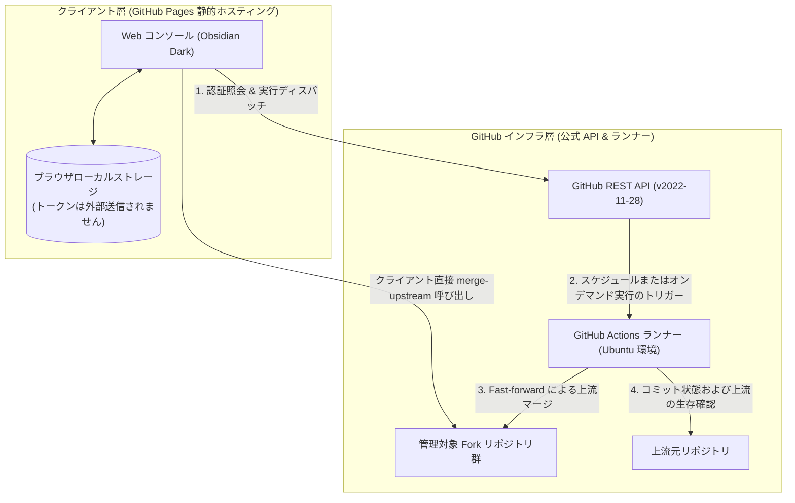

<div align="center">

# ForkSync Hub

**GitHub Fork リポジトリのクラウド自動同期エンジン & 運用ダッシュボード**

<p align="center">
  <a href="README.md">English</a> · 
  <a href="README_zh.md">简体中文</a> · 
  <a href="README_zh_tw.md">繁體中文</a> · 
  <b>日本語</b>
</p>

<p align="center">
  <a href="https://github.com/waw666waw666/fork-auto-sync/actions/workflows/sync.yml"></a>
  <a href="LICENSE"></a>
  
  
  
</p>

<p align="center">
  GitHub Fork リポジトリの上流同期を自動化するサーバーレスソリューション。<br />
  外部サーバーの保守は不要であり、ローカルマシンの負荷や認証情報の第三者漏洩リスクを排除します。
</p>

<p align="center">
  <a href="#概要">概要</a> •
  <a href="#ユーザーインターフェース">画面構成</a> •
  <a href="#システムアーキテクチャ">アーキテクチャ</a> •
  <a href="#主要機能">主要機能</a> •
  <a href="#デプロイ手順">デプロイ手順</a> •
  <a href="#設定仕様">設定仕様</a> •
  <a href="#セキュリティとデータ保護モデル">セキュリティ</a> •
  <a href="#よくある質問">FAQ</a> •
  <a href="#ライセンス">ライセンス</a>
</p>

---

</div>

## 概要

ForkSync Hub は、GitHub でフォークされた多数のリポジトリにおいて発生するコードの乖離（Upstream Drift）を解決するために設計されたオープンソースシステムです。

### 解決する課題

* **手動作業の削減**: 上流の更新ごとに各リポジトリページを開いて `Sync fork` を実行する手間を排除します。
* **ローカル環境の負荷軽減**: ローカル環境での定期スクリプト常駐によるマシンリソース消費や Git ブランチの競合を防ぎます。
* **認証情報の保護**: 外部 SaaS に書き込み権限付きトークンを預けることなく、公式 API との直接通信のみで運用します。

---

## ユーザーインターフェース

### メインダッシュボード

全 Fork リポジトリの追跡ブランチ、リリースバージョン、上流作者、同期ステータスを一元表示します。

<p align="center">
  
</p>

### クラウドスケジュールおよびルール設定

Web 画面から GitHub Actions の実行周期や除外リポジトリを直接更新できます。

<p align="center">
  
</p>

---

## システムアーキテクチャ



---

## 主要機能

| 機能項目 | 仕様・実装詳細 |
| :--- | :--- |
| **視覚的ダッシュボード** | エンジニアリング仕様のダークテーマ（`#0b0f19`）による状態一覧表示。 |
| **ゼロトラスト認証モデル** | パーソナルアクセストークン（PAT）はブラウザのローカルストレージにのみ保存され、中継サーバーを使用しません。 |
| **動的スケジュール管理** | 実行周期（2時間毎、6時間毎、1日2回、毎日09:00など）を Web 上から直接 `.github/workflows/sync.yml` に反映。 |
| **競合自動保護シールド** | 上流との間にコードの衝突（HTTP 409）が検出された場合、マージを即時中止し既存の独自コミットを保全。 |
| **上流削除時の自動保護** | 上流リポジトリが削除された場合（HTTP 404）は自動で同期を停止し、独立アーカイブとして保護。 |
| **デュアル実行パイプライン** | Web からの単一リポジトリ即時マージと、Actions によるクラウド一括処理を両立。 |
| **柔軟な除外設定** | `config.json` を通じたホワイトリスト・ブラックリスト管理に対応。 |
| **レート制限緩衝制御** | バッチ処理による段階的並行クエリとリポジトリ間待機時間により、GitHub API レート制限の超過を未然に防止。 |

---

## デプロイ手順

1. 本リポジトリ右上の **Fork** ボタンをクリックし、ご自身のアカウントに複製します。
2. GitHub [Personal Access Tokens (Classic)](https://github.com/settings/tokens) にて `repo` および `workflow` 権限を持つトークンを生成します。
3. Fork 先リポジトリの **Settings** → **Secrets and variables** → **Actions** にて、`SYNC_TOKEN` としてトークンを登録します。
4. **Settings** → **Pages** の **Source** を **GitHub Actions** に設定します。ビルド完了後、専用 URL にアクセスして利用を開始できます。

---

## 設定仕様

リポジトリルートの `config.json` にて除外設定を記述可能です：

```json
{
  "description": "ForkSync configuration file for repository exclusion and targeting.",
  "exclude": [
    "repo-name-to-skip",
    "organization/archived-project"
  ],
  "only": []
}
```

---

## ライセンス

本プロジェクトは [MIT ライセンス](LICENSE) のもとで公開されています。
