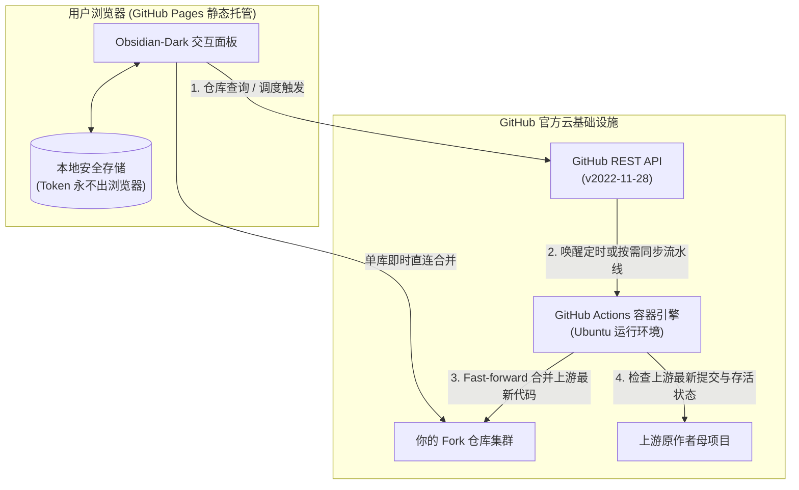

<div align="center">

# ForkSync Hub

**全自动 GitHub Fork 仓库云端同步器 · 现代化交互式 Web 控制台**

<p align="center">
  <a href="README.md">English</a> · 
  <b>简体中文</b> · 
  <a href="README_zh_tw.md">繁體中文</a> · 
  <a href="README_ja.md">日本語</a>
</p>

<p align="center">
  <a href="https://github.com/waw666waw666/fork-auto-sync/actions/workflows/sync.yml"></a>
  <a href="https://github.com/waw666waw666/fork-auto-sync/blob/main/LICENSE"></a>
  
  
  
</p>

<p align="center">
  <b>让你的所有 Fork 仓库与上游原作者永远保持最新，再也不用手动点击 Sync Fork。</b><br />
  <i>100% 无服务器架构，无需购买任何云主机，本地电脑零负载，无第三方数据中转泄露风险。</i>
</p>

<p align="center">
  <a href="#-1-分钟快速上手指南">快速上手</a> •
  <a href="#-为什么需要-forksync-hub">项目背景</a> •
  <a href="#-核心特性">核心特性</a> •
  <a href="#-系统架构">系统架构</a> •
  <a href="#-安全与隐私防护设计">安全与隐私</a> •
  <a href="#-配置说明">配置说明</a> •
  <a href="#-常见问题-faq">常见问题</a> •
  <a href="#-开源协议">开源协议</a>
</p>

---

</div>

> [!TIP]
> 🌐 **官方 Web 控制台在线体验**：**[https://waw666waw666.github.io/fork-auto-sync/](https://waw666waw666.github.io/fork-auto-sync/)**  
> *100% 浏览器本地零信任安全 — 你的个人凭据（Token）严格保存在当前浏览器本地，绝不经过任何第三方服务器中转。*

---

## 🎯 为什么需要 ForkSync Hub？

在 GitHub 上 Fork 了大量开源项目后，原作者（Upstream）一旦更新代码，你的 Fork 仓库就会逐渐落后：
- **传统方式痛点**：必须定期逐个打开每个仓库的主页手动点击 `Sync fork`，费时费力；或者在本地机器跑脚本，既要开机耗电，又容易弄乱本地 Git 分支。
- **现有工具局限**：市面上的 Action 脚本通常**没有任何可视化界面**，黑盒执行，无法直观掌握仓库状态与版本标签；而第三方同步 SaaS 则需要将个人核心 Token 上传给不知名的外部平台，存在重大安全隐患。

**ForkSync Hub 彻底解决了这一切**：将**现代化黑曜石深色 Web 交互面板**与 **GitHub Actions 官方容器执行引擎**完美融合。你不需要购买任何服务器，只要 **1 键 Fork** 本项目，即可免费拥有专属于你的自动化同步控制台！

---

## ✨ 核心特性

| 特性 | 说明 |
| :--- | :--- |
| 🌐 **沉浸式深色 Web 控制台** | 采用 Obsidian Dark (`#0b0f19`) 与 Emerald Green 极简工程美学。集中监控全部 Fork 仓库的跟踪分支、代码版本（Release Tag）、上游作者及同步状态。 |
| 🔒 **端到端纯前端零信任安全** | 访问凭证（PAT）**仅保存在当前浏览器本地存储**中，直接通过 HTTPS 与 GitHub 官方 REST API 握手通讯。绝无任何第三方中转，100% 开源透明。 |
| ⚙️ **Web 端实时调度控制** | 在网页上即可一键切换云端同步周期（每 2 小时 / 每 6 小时 / 每日 2 次 / 每日 09:00），直接通过 GitHub API 写回 `.github/workflows/sync.yml` 与 `config.json`，免去终端敲命令。 |
| 📦 **智能上游注销与删库防护** | 自动向上游探测存活状态。若母库已被原作者注销或删库（HTTP 404），系统自动标记为「📦 上游已删 · 绝版镜像」并安全锁定，避免破坏性 409 误报。 |
| ⚡ **双轨同步机制** | **网页秒级直调**：在单卡片上点击「立即同步」，浏览器直连 GitHub API 完成单库 upstream 合并并实时输出执行终端日志。<br/>**云端全量调度**：点击顶部「立即同步全部 Fork」，一键唤醒云端容器批量执行，带毫秒级轮询与耗时统计。 |
| 🛑 **细粒度黑白名单规则** | 支持随时在设置中勾选或排除指定仓库，需要保留定制改动的仓库可一键锁定，永不被上游冲刷。 |
| 📱 **全终端响应式自适应** | 针对手机、平板、桌面超宽屏深度适配，杜绝背景穿透滚动与多重滚动条，支持键盘快捷键（`/` 聚焦搜索，`Esc` 退出弹窗）。 |

---

## 🏗️ 系统架构



---

## 🚀 1 分钟快速上手指南

任何人只需三步，耗时不到 1 分钟即可部署好自己的专属同步平台：

### 第一步：Fork 本仓库
点击本页面右上角的 **Fork** 按钮，将本仓库复制到你的 GitHub 个人账号下。

### 第二步：配置 GitHub Actions 密钥
1. 访问 GitHub [Tokens 设置页面 (Classic)](https://github.com/settings/tokens)。
2. 生成一个新 Token，勾选以下权限：
   - `repo`（完整读写仓库代码）
   - `workflow`（允许更新工作流配置与调度 Actions）
3. 进入你 Fork 出来的仓库主页，点击 **Settings** → **Secrets and variables** → **Actions**。
4. 点击 **New repository secret**：
   - **Name**: `SYNC_TOKEN`
   - **Secret**: 粘贴刚才生成的 Personal Access Token。

### 第三步：开启 GitHub Pages 专属网页
1. 进入仓库 **Settings** → **Pages**。
2. 在 **Build and deployment** 下的 **Source** 中，选择 **GitHub Actions**。
3. 内置流水线将自动编译并发布你的专属控制台：
   ```
   https://<你的用户名>.github.io/fork-auto-sync/
   ```
4. 打开该链接，在私密锁屏中输入你的 Token 解锁，即可开始掌控你的所有 Fork 仓库！

---

## ⚙️ 配置说明

ForkSync Hub 既可以通过 **Web 界面中的设置弹窗** 可视化修改，也可以直接编辑仓库根目录下的 `config.json`：

```json
{
  "description": "Fork 自动同步配置文件。修改此文件可控制哪些 Fork 自动同步、哪些跳过。",
  "exclude": [
    "repo-to-skip",
    "username/archived-project"
  ],
  "only": []
}
```

- `exclude`: 需要排除的仓库名称或完整路径（`owner/repo`），在此名单中的仓库**永远不会**被自动同步覆写。
- `only`: （可选）仅同步指定的仓库。当填入内容时，其他未列出的仓库将自动被跳过。

---

## 🔒 安全与隐私防护设计

安全是 ForkSync Hub 最核心的设计原则：

1. **零中间服务器**：控制面板作为静态 SPA 完全寄存于 GitHub Pages。无后端数据库、无数据收集、无任何第三方分析追踪。
2. **纯本地凭据存储**：你的 GitHub Token 只存在于浏览器 `localStorage` 或 `sessionStorage`，仅向 `https://api.github.com` 发起官方加密请求。
3. **冲突绝对保护**：当上游与你发生代码冲突（HTTP 409）时，系统**绝不强行覆盖破坏你的代码**，而是安全挂起并提供快速跳转对比。
4. **绝版孤本镜像锁定**：上游原项目 404 删库时，系统自动挂起并锁定，确保你账号中的代码成为永久孤本备份。

---

## ❓ 常见问题 (FAQ)

<details>
<summary><b>Q: 运行这个项目需要付费吗？</b></summary>
<b>完全免费。</b> GitHub Actions 和 GitHub Pages 对公开仓库 100% 免费提供。即便你使用私有仓库，GitHub 也会每月赠送 2000+ 分钟免费 Actions 时长，足够进行上万次同步。
</details>

<details>
<summary><b>Q: 为什么 Token 需要 <code>workflow</code> 权限？</b></summary>
GitHub 官方安全规则限制：修改 <code>.github/workflows/*.yml</code> 文件（例如在 Web 端切换定时频率）或调用 dispatches 调度必须具备 <code>workflow</code> 权限。Token 绝不离端，请放心授权。
</details>

<details>
<summary><b>Q: 如果上游母项目与我自己的修改冲突了会怎样？</b></summary>
系统内置严苛的安全防线。检测到代码冲突时，GitHub 会返回 HTTP 409，此时系统会自动停止合并，并在控制台上高亮显示「冲突安全保护」，提供直达 GitHub 的比对链接，绝不破坏你的分支。
</details>

<details>
<summary><b>Q: 可以同步私有 Fork 仓库吗？</b></summary>
可以。只要你的 Personal Access Token 勾选了 <code>repo</code> 权限，你名下的所有私有 Fork 仓库也会安全、私密地展示在你的控制台中。
</details>

---

## 🤝 贡献与反馈

欢迎提交 PR、提出 Issue 或分享新特性建议！  
请访问项目的 [GitHub Issues 讨论区](https://github.com/waw666waw666/fork-auto-sync/issues)。

---

## 📄 开源协议

本项目采用 [MIT 许可证](LICENSE) 开源。  
欢迎自由 Fork、定制与二次分发！
