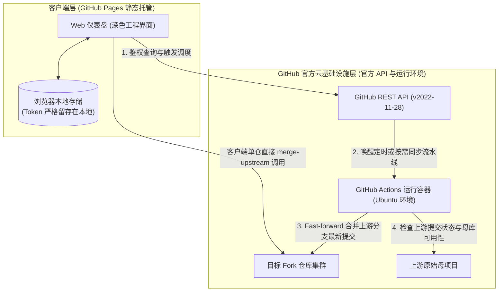

<div align="center">

# ForkSync Hub

**全自动 GitHub Fork 仓库云端同步引擎与交互式 Web 控制台**

<p align="center">
  <a href="README.md">English</a> · 
  <b>简体中文</b> · 
  <a href="README_zh_tw.md">繁體中文</a> · 
  <a href="README_ja.md">日本語</a>
</p>

<p align="center">
  <a href="https://github.com/waw666waw666/fork-auto-sync/actions/workflows/sync.yml"></a>
  <a href="LICENSE"></a>
  
  
  
</p>

<p align="center">
  持续、全自动的 GitHub Fork 仓库上游同步与可视化运维工作台。<br />
  完全基于 Serverless 基础设施运行，无需维护物理服务器，本地电脑零计算负载，杜绝第三方凭证泄露风险。
</p>

<p align="center">
  <a href="#概述">概述</a> •
  <a href="#系统界面">系统界面</a> •
  <a href="#系统架构">系统架构</a> •
  <a href="#核心能力">核心能力</a> •
  <a href="#部署指南">部署指南</a> •
  <a href="#配置规范">配置规范</a> •
  <a href="#安全与数据隐私模型">安全与隐私</a> •
  <a href="#技术常见问题">FAQ</a> •
  <a href="#开源协议">开源协议</a>
</p>

---

</div>

## 概述

ForkSync Hub 是专为解决 GitHub Fork 仓库代码落后（Upstream Drift）而设计的开源云端自动化运维方案。

### 背景分析

在管理多个或大批量的 Fork 项目时，开发者通常面临以下运维成本：
* **人工操作繁琐**：每次上游更新均需手动逐个打开仓库网页执行 `Sync fork`。
* **本地维护负担**：依赖本地常驻进程或定时脚本容易占用计算资源，且存在 Git 本地分支脏污与冲突隐患。
* **第三方 SaaS 安全隐患**：外部同步服务往往要求提交包含仓库写权限的个人访问令牌（PAT）至未经验证的第三方服务器，带来重大安全风险。

### 解决方案

ForkSync Hub 将部署在 GitHub Pages 上的客户端零信任单页应用（SPA）与运行于 GitHub Actions 的自动化容器流水线整合。系统直接通过 HTTPS 协议与 GitHub 官方 REST API 通讯，实现全自动追踪、冲突安全保护与即时调度控制，全程无需额外部署任何后端或中转服务。

---

## 系统界面

### 监控主仪表盘

集中呈现受控 Fork 仓库的整体健康度、跟踪分支、代码版本（Release Tag）、上游来源及最新同步时间戳。

<p align="center">
  
</p>

### 云端调度与规则设置

支持在 Web 界面中直接调整 Actions 定时触发周期及黑白名单排除规则，修改通过 GitHub API 原生提交生效，免除命令行操作。

<p align="center">
  
</p>

---

## 系统架构

下图展示了系统单向数据流向及客户端凭证与云端执行之间的零信任边界：



---

## 核心能力

| 能力项 | 详细规范 |
| :--- | :--- |
| **可视化运维面板** | 采用 Obsidian 深色工程风格（`#0b0f19`），实时展示跟踪分支、发布版本、上游作者及同步时间戳。 |
| **客户端零信任安全模型** | 个人访问令牌（PAT）仅留存在当前浏览器存储中，直接面向 `https://api.github.com` 通讯，绝无任何中间转发服务器。 |
| **云端调度动态配置** | 支持在 Web 界面直观切换同步周期（每 2 小时、每 6 小时、每日 2 次、每日 09:00 UTC+8），直接提交写入 `.github/workflows/sync.yml`。 |
| **上游删库与注销防护** | 自动向上游发起存活检测。若原作者已删库或注销账号（HTTP 404），系统自动锁定该仓库为「上游已删 · 绝版镜像」，防止破坏性误报。 |
| **双轨同步执行模式** | **即时单仓合并**：在卡片端直接调用 GitHub `merge-upstream` 接口，毫秒级合并并输出控制台终端日志。<br/>**全量云端调度**：一键唤醒 GitHub Actions 批量执行，配合轮询监听与耗时统计。 |
| **细粒度黑白名单过滤** | 支持通过 `config.json` 声明排除名单与指定名单，保护存在自定义改动的分支不被强行同步。 |
| **全终端响应式与可访问性** | 深度适配桌面、平板与移动端屏幕，杜绝背景穿透滚动与双滚动条，提供键盘快捷键（`/` 快速聚焦搜索，`Esc` 退出浮层）。 |

---

## 部署指南

整体部署过程约需 60 秒，完全依托 GitHub 官方提供的免费配额：

### 第一步：Fork 本仓库
点击本页面右上角的 **Fork** 按钮，将仓库复制至你的个人或组织 GitHub 账号下。

### 第二步：配置工作流密钥
1. 访问 GitHub [Personal Access Tokens (Classic)](https://github.com/settings/tokens) 页面。
2. 创建新令牌，并勾选以下必要作用域：
   * `repo`（完整管理公有与私有仓库）
   * `workflow`（更新工作流定义文件与调用 Actions 调度）
3. 进入你 Fork 出的仓库主页，点击 **Settings** → **Secrets and variables** → **Actions**。
4. 点击 **New repository secret**：
   * **Name**: `SYNC_TOKEN`
   * **Secret**: 粘贴上述生成的个人访问令牌。

### 第三步：开启 GitHub Pages 服务
1. 在仓库中依次进入 **Settings** → **Pages**。
2. 在 **Build and deployment** 下的 **Source** 项中，选择 **GitHub Actions**。
3. 内置流水线将自动编译并发布控制台至专属域名：
   ```
   https://<你的用户名>.github.io/fork-auto-sync/
   ```
4. 打开该链接，输入令牌解锁后即可开始使用。

---

## 配置规范

仓库同步策略既可在 Web 界面弹窗中操作，也可通过直接编辑仓库根目录下的 `config.json` 实现：

```json
{
  "description": "ForkSync configuration file for repository exclusion and targeting.",
  "exclude": [
    "repo-name-to-skip",
    "organization/archived-project"
  ],
  "only": []
}
```

### 参数定义

* `exclude` (`string[]`): 声明不参与同步的仓库名称（`repo`）或全路径（`owner/repo`）。列表中的仓库将保持静止，绝不被更新覆盖。
* `only` (`string[]`): （可选）仅同步列表内声明的仓库。配置后系统将忽略其他未列出的仓库。

---

## 安全与数据隐私模型

系统遵循严谨的工程安全准则：

1. **零外部数据流转**：除 GitHub 官方 API 接口外，系统不与任何第三方域名产生网络交互。
2. **瞬态运行环境**：GitHub Actions 流水线运行于完全隔离的 Ubuntu 虚拟环境中，作业结束后销毁临时运行数据。
3. **合并保护机制**：遇代码冲突（HTTP 409）时，系统自动跳过该仓库的合并，严禁强制覆盖（`--force`），并在界面提供一键直达的 Web Diff 对比链接。
4. **404 孤本保护机制**：遇上游母库不存在时自动安全挂起，保护唯一代码备份完好。

---

## 技术常见问题

<details>
<summary><b>使用本项目会产生费用吗？</b></summary>
不会。对于公开仓库，GitHub Actions 与 GitHub Pages 完全免费。即便对于私有仓库，GitHub 账号每月均附带充足的免费 Actions 运行分钟数（通常为 2,000+ 分钟/月），完全覆盖正常同步需求。
</details>

<details>
<summary><b>为什么访问令牌必须包含 <code>workflow</code> 权限？</b></summary>
GitHub 平台安全规则规定：凡修改 <code>.github/workflows/*.yml</code> 文件（如在 Web 界面变更定时频率）或手动触发 dispatches 任务，均必须持有 <code>workflow</code> 作用域。令牌仅留存于本地浏览器，安全性受端到端加密保护。
</details>

<details>
<summary><b>发生代码冲突时系统如何处理？</b></summary>
同步引擎严格遵循非破坏性合并策略。若检测到 HTTP 409 冲突响应，系统立即中止当前仓库的合并动作，在界面标注冲突警告标签，并提供原厂 GitHub 对比视图链接，绝不覆写用户分支。
</details>

<details>
<summary><b>系统是否支持私有 Fork 仓库？</b></summary>
支持。只要生成的访问令牌具备 <code>repo</code> 权限，你名下的私有 Fork 仓库均会在鉴权通过后正常呈现与同步。
</details>

---

## 贡献指南

欢迎通过 GitHub 标准的 Pull Request 与 Issue 流程提交改进建议或缺陷报告。提交前请检索现有讨论以避免重复。

---

## 开源协议

本项目基于 [MIT 许可证](LICENSE) 发布。
