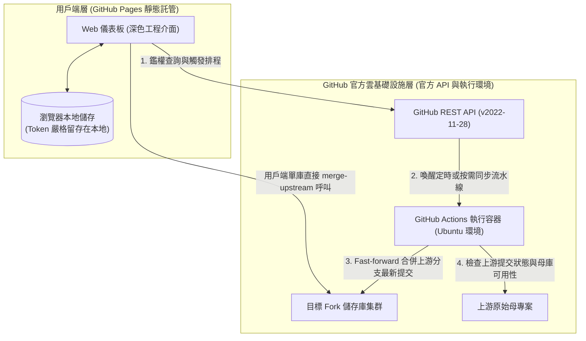

<div align="center">

# ForkSync Hub

**全自動 GitHub Fork 專案雲端同步引擎與互動式 Web 控制台**

<p align="center">
  <a href="README.md">English</a> · 
  <a href="README_zh.md">简体中文</a> · 
  <b>繁體中文</b> · 
  <a href="README_ja.md">日本語</a>
</p>

<p align="center">
  <a href="https://github.com/waw666waw666/fork-auto-sync/actions/workflows/sync.yml"></a>
  <a href="LICENSE"></a>
  
  
  
</p>

<p align="center">
  持續、全自動的 GitHub Fork 專案上游同步與視覺化運維工作台。<br />
  完全基於 Serverless 基礎設施運行，無須維護實體伺服器，本地電腦零運算負載，杜絕第三方憑證外洩風險。
</p>

<p align="center">
  <a href="#概述">概述</a> •
  <a href="#系統介面">系統介面</a> •
  <a href="#系統架構">系統架構</a> •
  <a href="#核心能力">核心能力</a> •
  <a href="#部署指南">部署指南</a> •
  <a href="#設定規範">設定規範</a> •
  <a href="#安全與資料隱私模型">安全與隱私</a> •
  <a href="#技術常見問題">FAQ</a> •
  <a href="#開源協議">開源協議</a>
</p>

---

</div>

## 概述

ForkSync Hub 是專為解決 GitHub Fork 專案程式碼落後（Upstream Drift）而設計的開源雲端自動化運維方案。

### 背景分析

在管理多個或大批量的 Fork 專案時，開發者通常面臨以下運維成本：
* **人工操作繁瑣**：每次上游更新均需手動逐一打開儲存庫首頁執行 `Sync fork`。
* **本地維護負擔**：依賴本地常駐行程或定時腳本容易佔用運算資源，且存在 Git 本地分支髒污與衝突隱患。
* **第三方 SaaS 安全隱患**：外部同步服務往往要求提交包含儲存庫寫入權限的個人存取權杖（PAT）至未經驗證的第三方伺服器，帶來重大資安風險。

### 解決方案

ForkSync Hub 將部署在 GitHub Pages 上的用戶端零信任單頁應用（SPA）與運行於 GitHub Actions 的自動化容器流水線整合。系統直接透過 HTTPS 協定與 GitHub 官方 REST API 通訊，實現全自動追蹤、衝突安全保護與即時排程控制，全程無須額外部署任何後端或中轉服務。

---

## 系統介面

### 監控主儀表板

集中呈現受控 Fork 儲存庫的整體健康度、追蹤分支、程式碼版本（Release Tag）、上游來源及最新同步時間戳。

<p align="center">
  
</p>

### 雲端排程與規則設定

支援在 Web 介面中直接調整 Actions 定時觸發週期及黑白名單排除規則，修改透過 GitHub API 原生提交生效，免除命令列操作。

<p align="center">
  
</p>

---

## 系統架構



---

## 核心能力

* **視覺化運維面板**：採用 Obsidian 深色工程風格（`#0b0f19`），即時展示追蹤分支、發布版本、上游作者及同步時間戳。
* **用戶端零信任安全模型**：個人存取權杖（PAT）僅留存在目前瀏覽器儲存中，直接面向 `https://api.github.com` 通訊，絕無任何中間轉發伺服器。
* **雲端排程動態配置**：支援在 Web 介面直觀切換同步週期（每 2 小時、每 6 小時、每日 2 次、每日 09:00 UTC+8），直接提交寫入 `.github/workflows/sync.yml`。
* **上游刪庫防護**：自動向上游發起存活檢測。若原作者已刪庫或註銷帳號（HTTP 404），系統自動鎖定該儲存庫為「上游已刪 · 絕版鏡像」，防止破壞性誤報。
* **雙軌同步執行模式**：支援卡片端即時呼叫 GitHub `merge-upstream` 介面，亦支援透過 Actions 進行批次排程執行。
* **細粒度黑白名單過濾**：支援透過 `config.json` 聲明排除名單與指定名單，保護存在自訂修改的分支不被強行同步。

---

## 部署指南

1. 點擊本頁面右上角 **Fork** 按鈕將儲存庫複製至你的個人帳號。
2. 前往 GitHub [Personal Access Tokens (Classic)](https://github.com/settings/tokens) 產生具備 `repo` 與 `workflow` 權限的權杖。
3. 在 Fork 儲存庫的 **Settings** → **Secrets and variables** → **Actions** 中新增密鑰 `SYNC_TOKEN`。
4. 前往 **Settings** → **Pages**，將 **Source** 設定為 **GitHub Actions** 即可完成自動部署。

---

## 設定規範

儲存庫同步策略可透過編輯儲存庫根目錄下的 `config.json` 實現：

```json
{
  "description": "ForkSync configuration file for repository exclusion and targeting.",
  "exclude": [
    "repo-name-to-skip",
    "organization/archived-project"
  ],
  "only": []
}
```

---

## 開源協議

本專案基於 [MIT 授權條款](LICENSE) 發布。
